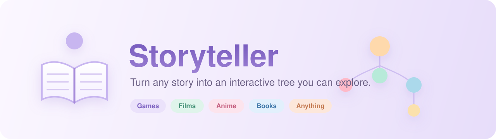
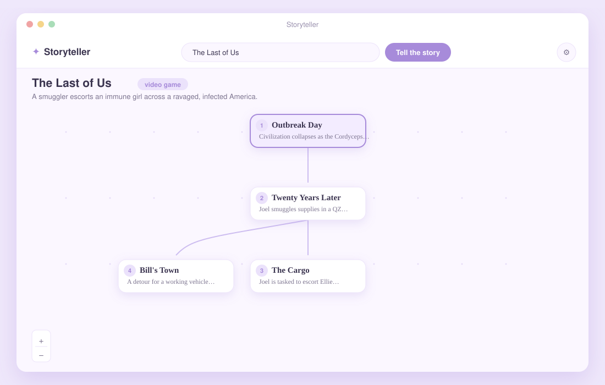
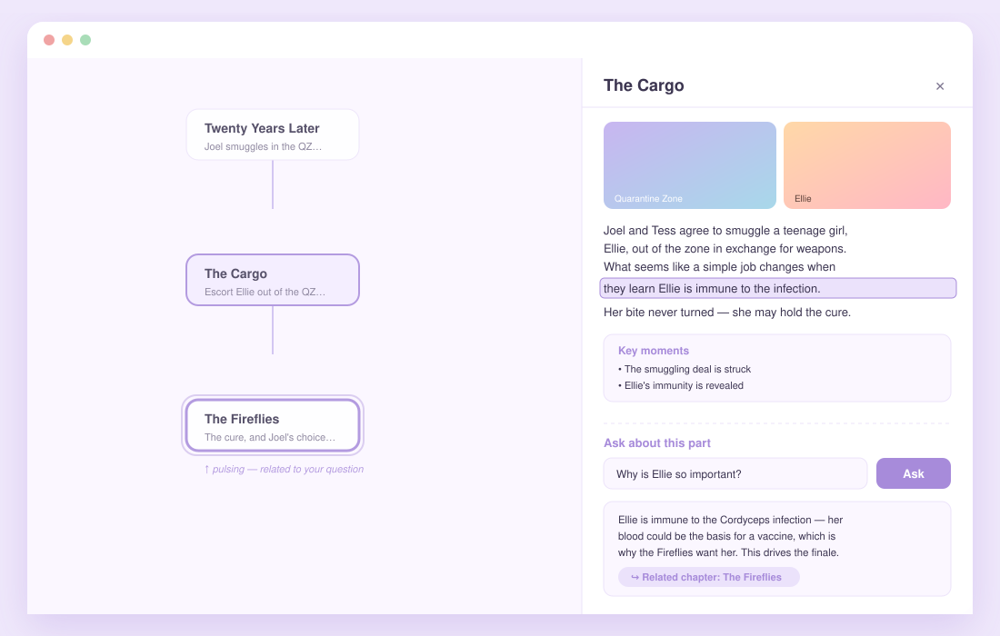
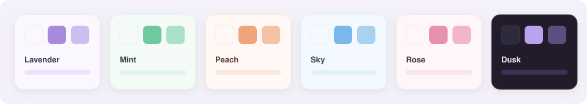
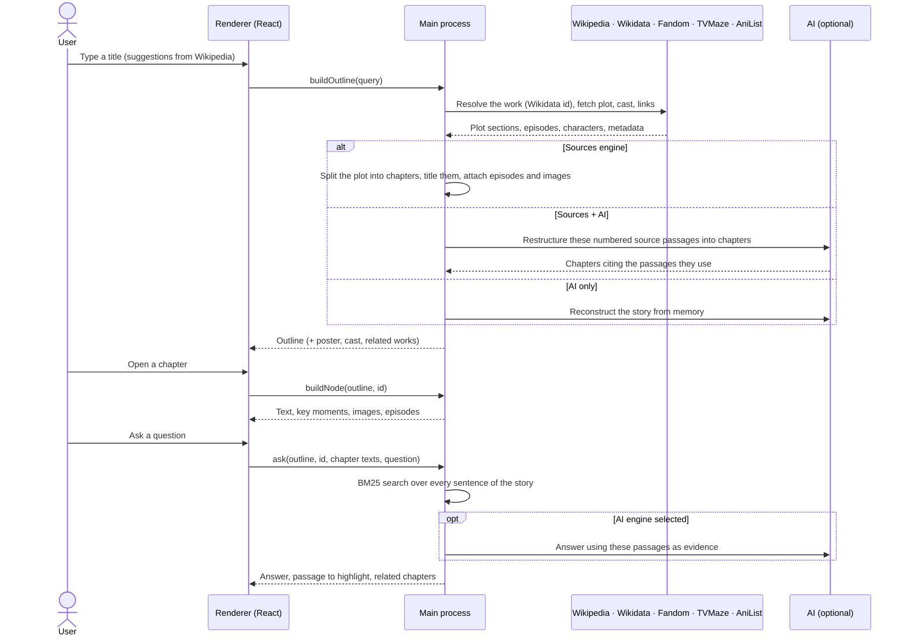
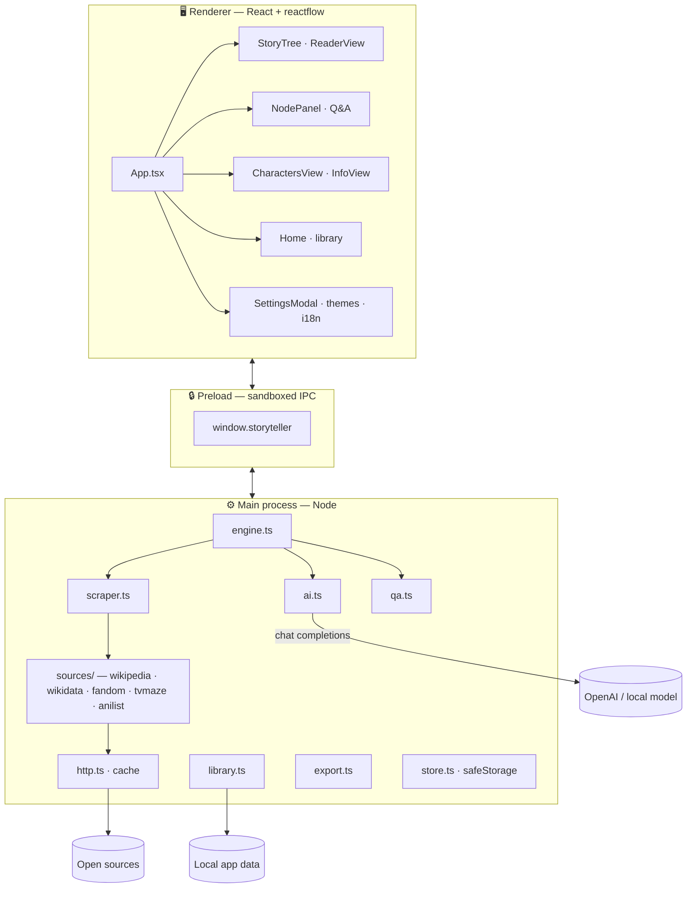

<div align="center">



<br/>

**Type the name of _any_ work — a game, film, anime, series, book or comic — and Storyteller rebuilds its entire story as an interactive, clickable map of chapters. It works with no AI at all, straight from open sources, and can use AI as an optional upgrade.**

<br/>

[](#-installation)
[](https://www.electronjs.org/)
[](https://react.dev/)
[](https://www.typescriptlang.org/)
[](#-story-engines)
[](#-license)

<br/>

[**Features**](#-features) · [**Engines**](#-story-engines) · [**Demo**](#-demo) · [**How it works**](#-how-it-works) · [**Install**](#-installation) · [**Architecture**](#-architecture) · [**Roadmap**](#-roadmap)

<br/>



</div>

---

## ✨ Overview

Most summaries dump an entire plot into one wall of text. **Storyteller** instead turns a story into a **map you can walk through**:

1. You search a title (with live suggestions, covers and descriptions to pick the right one).
2. Storyteller gathers the plot — from Wikipedia, Fandom wikis, TVMaze and AniList, or from an AI — and lays the whole tale out, ending included, as a **chronological map of chapters**.
3. You open any chapter to read it in full, with images, key moments and, for series, every episode.
4. Stuck on something? **Ask a question inside the chapter.** The answer highlights the exact passage and pulses the related chapter on the map — offline, by searching the story text, or with AI.

It's a polished, minimalist **desktop app** with pastel theming. No account and no key are needed: AI is an optional engine you can switch on at any time, with your own OpenAI key or a free local model.

---

## 🧭 Story engines

Pick one from the engine button in the top bar. All three use the open sources for posters, cast, franchise links and images.

| Engine | Needs | What happens |
|---|---|---|
| 📚 **Sources** (default) | nothing | The plot is scraped from Wikipedia (your language first, English as fallback), Fandom wikis and TVMaze/AniList, then split into chapters locally: by the article's own sub-headings when it has them, otherwise into balanced chunks titled by the names that are distinctive to each (e.g. *"Mann & KIPP"*). Q&A is a local BM25 search over the story text. |
| 🧩 **Sources + AI** | key or local model | The scraped plot is handed to the model as numbered source passages. It restructures and translates **real plot text** instead of recalling it, and each chapter is narrated from the passages it cites, so far fewer events are invented. |
| ✨ **AI only** | key or local model | The model tells the story from its own knowledge. Useful for obscure works with no wiki plot. |

Even in **Sources** mode you can press **Retell with AI** on a single chapter, and questions switch to AI answers when an AI engine is selected. If the AI fails (quota, no connection), questions fall back to the local search instead of showing an error.

---

## 🌟 Features

| | Feature | Description |
|---|---|---|
| 🌳 | **Story as a map** | Any work's full plot as an ordered, clickable chapter graph. Linear stories use a serpentine layout so 15 chapters fit one screen; branching ones use a tidy tree. Mini-map, zoom and auto-centering on the open chapter. |
| 🔎 | **Smart search** | Search-as-you-type over Wikipedia with covers and descriptions, typo correction (*"Hollow Knigt"*), creative works ranked above look-alike pages, and an English fallback. |
| 📺 | **Series and anime** | Seasons with every episode summary and still (TVMaze). Seasons in your language's Wikipedia get their episode lists attached; 60-episode anime seasons are split into readable blocks. |
| 💬 | **Ask inside any chapter** | Answers highlight the exact passage, link to the related chapter and list other chapters that mention it. Works offline. |
| 📖 | **Reader mode** | The whole story as one continuous text with a table of contents; chapters are marked read as you scroll. |
| 👥 | **Characters** | Cast with photos and performers (AniList, TVMaze, Wikidata + Wikipedia), ranked by how often the story mentions them. One click shows the chapters they appear in. |
| ℹ️ | **About the work** | Year, creators, genres, score, prequels / sequels / adaptations you can open directly, other matches for ambiguous titles, and a switch to rebuild the chapters from another plot source. |
| 📚 | **Library and progress** | Every story is saved locally with reading progress, favorites and the last chapter. AI stories reopen without spending tokens. |
| 🙈 | **Spoiler shield** | Blurs the summaries of chapters you haven't read yet. |
| 🔍 | **Find in story** | Filter the map and the reader by any word or character name. |
| 🔊 | **Read aloud** | Listen to a chapter with your system voices (offline). |
| 📤 | **Export and import** | Markdown, PDF, or a Storyteller file you can share and import back. |
| 🖼️ | **Story images** | Fandom screenshots of the actual scenes, plus Wikipedia/Commons images that must name what was searched for. Click to enlarge. |
| 🎨 | **Seven themes + system** | Lavender, Mint, Peach, Sky, Rose, and the dark Dusk and Night — or follow the OS. Sans or serif reading font, adjustable text size. |
| 🌐 | **Seven interface languages** | Starts in English; switch to Português (Brasil), Español, Français, Deutsch, Italiano or 日本語 on the welcome screen or in Settings. Stories follow the interface language unless you pick another one. |
| 🤖 | **Any OpenAI-compatible model** | OpenAI, or a local server such as Ollama or LM Studio (any `/v1` endpoint). Reasoning models (o-series, gpt-5) are supported. |
| ⌨️ | **Keyboard first** | `Ctrl K` or `/` to search, `←` `→` (or `J` `K`) between chapters, `Esc` to close. |
| 🔐 | **Local-first and private** | Your key is encrypted by the OS and never reaches the UI process. Source lookups are cached for a week, so saved stories open offline. |

---

## 🎬 Demo

> The screens below are rendered mockups of the actual UI.

<div align="center">

### Explore the whole story at a glance


<br/><br/>

### Read a chapter, ask a question, follow the thread


<br/><br/>

### Make it yours — pastel themes, light and dark


</div>

---

## 🔭 How it works



**Why the Wikidata id matters.** A title like *Dune* is ambiguous; the Wikidata item is not. Once it's known, Storyteller gets the exact article in every language and exact TVMaze, AniList, IMDb and Fandom ids, so later lookups never guess.

**Why a tree (and not a flat list)?** Stories rarely move in a perfectly straight line. Outlines are normalized into a valid tree: unique ids, one root, and a parent always placed before its child, which rules out cycles and dangling links even when a model returns a malformed graph.

---

## 🚀 Installation

### Option A — Download a release

Get the file for your system from the [Releases](../../releases) page:

| Platform | File | First launch |
|---|---|---|
| **Windows** 10/11 | `Storyteller-x.y.z-windows-setup.exe` | SmartScreen may warn (unsigned build) → **More info → Run anyway**. |
| **macOS** Apple Silicon / Intel | `Storyteller-x.y.z-mac-arm64.dmg` / `-mac-x64.dmg` | Drag to Applications, then **right-click → Open**. If it still refuses: `xattr -cr /Applications/Storyteller.app`. |
| **Linux** | `Storyteller-x.y.z-linux-x86_64.AppImage` or `-linux-amd64.deb` | `chmod +x` the AppImage, or `sudo apt install ./Storyteller-*.deb`. |
| **Android** 7.0+ | `Storyteller-x.y.z-android.apk` | Allow installing from your browser / file manager when asked. |

Then pick **Without AI** to start right away, or **With AI** to connect an [OpenAI key](https://platform.openai.com/api-keys) or a local model.

### Option B — Build from source

> **Prerequisites:** [Node.js 22+](https://nodejs.org/) and npm. For Android, also JDK 21 and the Android SDK (Android Studio installs both).

```bash
git clone https://github.com/Ernani1234/storyteller.git
cd storyteller
npm install

npm run dev            # desktop app with hot reload
npm run dist           # installer for the system you're on → release/
npm run android:apk    # Android APK → release/
```

The same React UI runs everywhere. On desktop it talks to Electron's main process; on Android (and in a browser) the core runs inside the page through [Capacitor](https://capacitorjs.com/), with the library in IndexedDB.

| Script | What it does |
|---|---|
| `npm run dev` | Launch the desktop app with hot reloading. |
| `npm run typecheck` | Type-check main, core, preload and renderer. |
| `npm run build` | Type-check, then bundle main / preload / renderer. |
| `npm run icon` | Rasterize `build/icon.svg` → `icon.ico` + `icon.png`. |
| `npm run icon:android` | Regenerate Android launcher icons and splash screens. |
| `npm run dist` | Installer for the current OS (`dist:win`, `dist:mac`, `dist:linux` to pick one). |
| `npm run dist:dir` | Unpacked app folder, no installer. |
| `npm run build:mobile` | Build the UI for Android / browsers into `out/mobile`. |
| `npm run preview:mobile` | Serve that build locally (try it in a phone-sized window). |
| `npm run android:apk` | Build the Android release APK (`android:apk:debug` for a debug one). |
| `npm run android:open` | Open the Android project in Android Studio. |

macOS builds need a Mac and Linux builds need Linux; the [release workflow](.github/workflows/release.yml) builds all four platforms on GitHub Actions.

### Publishing a release

Push a version tag and GitHub Actions builds Windows, macOS, Linux and Android and attaches everything to a new release:

```bash
npm version 2.1.0   # bumps package.json (Android reads its version from there)
git push --follow-tags
```

**Signed Android updates (recommended).** Without a key, the APK is signed with a throwaway debug key, so each release has to be uninstalled before installing the next. Create one release key and add it as repository secrets once:

```bash
keytool -genkeypair -v -keystore storyteller-release.jks -alias storyteller \
  -keyalg RSA -keysize 2048 -validity 10000
base64 -w0 storyteller-release.jks   # → secret ANDROID_KEYSTORE_BASE64
```

Also add `ANDROID_KEYSTORE_PASSWORD`, `ANDROID_KEY_ALIAS` (`storyteller`) and `ANDROID_KEY_PASSWORD`. Keep the `.jks` file safe and out of the repository: losing it means users must reinstall.

---

## ⚙️ Configuration

Everything lives in **Settings** (the sliders icon, top-right):

- **Appearance**: theme (or *match system*), interface language, reading font, text size, spoiler shield.
- **Story engine**: Sources, Sources + AI or AI only; story language; which sources to use (Wikipedia/Wikidata, Fandom, TVMaze, AniList).
- **AI**: API key (encrypted by the OS), optional OpenAI-compatible endpoint (e.g. `http://localhost:11434/v1` for Ollama), model with **List my models**, and **Test connection**.
- **Data**: cache size and clearing, number of saved stories, the data folder, keyboard shortcuts.

---

## 🏗️ Architecture

On desktop the **main process** owns the API key and every network call; the **renderer** never sees the key and talks to main only through a typed, context-isolated, sandboxed bridge. On Android the same **core** runs inside the app's WebView behind the same bridge interface, with requests going through Capacitor's native HTTP.



<details>
<summary><b>📁 Project structure</b></summary>

```
storyteller/
├─ build/icon.svg               # source app icon → rasterized to .ico/.png
├─ docs/assets/                 # README artwork
├─ scripts/generate-icon.mjs    # SVG → multi-size .ico
├─ src/
│  ├─ core/                     # runs on every platform (no Node or Electron APIs)
│  │  ├─ engine.ts              #   picks Sources / Sources + AI / AI only
│  │  ├─ scraper.ts             #   sources → chapters (no AI)
│  │  ├─ ai.ts                  #   OpenAI-compatible calls, grounding, JSON repair
│  │  ├─ qa.ts                  #   offline answers (BM25 over sentences)
│  │  ├─ library.ts             #   saved stories + progress
│  │  ├─ exporting.ts           #   Markdown / HTML / JSON, import validation
│  │  ├─ http.ts · images.ts    #   fetch with cache and retry, chapter images
│  │  ├─ config.ts              #   what each host plugs in (settings, storage)
│  │  └─ sources/               #   wikipedia, wikidata, fandom, tvmaze, anilist, html
│  ├─ main/                     # Electron host: window, IPC, files, OS-encrypted key, PDF
│  ├─ preload/index.ts          # typed contextBridge API (desktop)
│  ├─ renderer/src/
│  │  ├─ App.tsx
│  │  ├─ components/            #   StoryTree, NodePanel, ReaderView, CharactersView, InfoView, Home…
│  │  ├─ platform/              #   Android / browser host: IndexedDB, share sheet, back button
│  │  ├─ lib/                   #   layout (tree + serpentine), tts, scroll
│  │  ├─ i18n/                  #   en (keys) + pt, es, fr, de, it, ja
│  │  └─ themes.ts
│  └─ shared/                   # types, the bridge API, text and tree utilities
├─ android/                     # Capacitor Android project
├─ capacitor.config.json
├─ vite.mobile.config.ts        # UI build for Android / browsers
├─ .github/workflows/release.yml
└─ electron-builder.yml
```
</details>

---

## 🧱 Tech stack

| Layer | Tech |
|---|---|
| **Desktop shell** | [Electron 31](https://www.electronjs.org/) + [electron-vite](https://electron-vite.org/) |
| **UI** | [React 18](https://react.dev/), [reactflow](https://reactflow.dev/) for the map |
| **Language** | [TypeScript 5](https://www.typescriptlang.org/) (strict) |
| **Sources** | Wikipedia (TextExtracts), Wikidata, Fandom (MediaWiki API), [TVMaze](https://www.tvmaze.com/api), [AniList](https://anilist.gitbook.io/anilist-apiv2-docs/) — no keys required |
| **AI (optional)** | [OpenAI SDK](https://github.com/openai/openai-node) against OpenAI or any compatible server |
| **Persistence** | [electron-store](https://github.com/sindresorhus/electron-store) + Electron `safeStorage`, JSON library files |
| **Packaging** | [electron-builder](https://www.electron.build/) (NSIS), [sharp](https://sharp.pixelplumbing.com/) for icons |

---

## 🔐 Privacy & security

- In **Sources** mode nothing needs an account: the app only queries the public APIs listed above and caches the answers locally.
- Your API key is entered at runtime, **encrypted with the operating system's key store** (DPAPI on Windows) and kept in the main process. The interface only ever sees a masked hint such as `sk-…a1b2`.
- AI requests go **directly from your machine** to the endpoint you configured; there is no middle-man server.
- The renderer runs **sandboxed with context isolation** and a locked-down Content-Security-Policy. The window can't navigate away, and links open in your browser only if they are `http(s)`.
- Imported story files are validated field by field before they are saved.
- Text from Wikipedia and Fandom is CC BY-SA: every chapter shows its sources, and the About tab lists them with their licenses.

---

## 🗺️ Roadmap

- [x] Export a story to PDF / Markdown
- [x] Reading progress, favorites and a local library
- [x] Works without AI (open sources), with AI as an option
- [x] Local models (Ollama, LM Studio)
- [ ] Streaming chapter text (token-by-token reveal)
- [ ] More plot sources (TMDB, IGDB, Open Library)
- [x] macOS, Linux and Android builds

---

## 🤝 Contributing

Contributions are welcome! Open an issue to discuss a change, or send a PR. Please run `npm run build` (type-check + bundle) before submitting.

---

## 📄 License

[MIT](LICENSE) © Ernani Neto

<div align="center">
<br/>
<sub>Built with ✦ — turning stories into maps.</sub>
</div>
